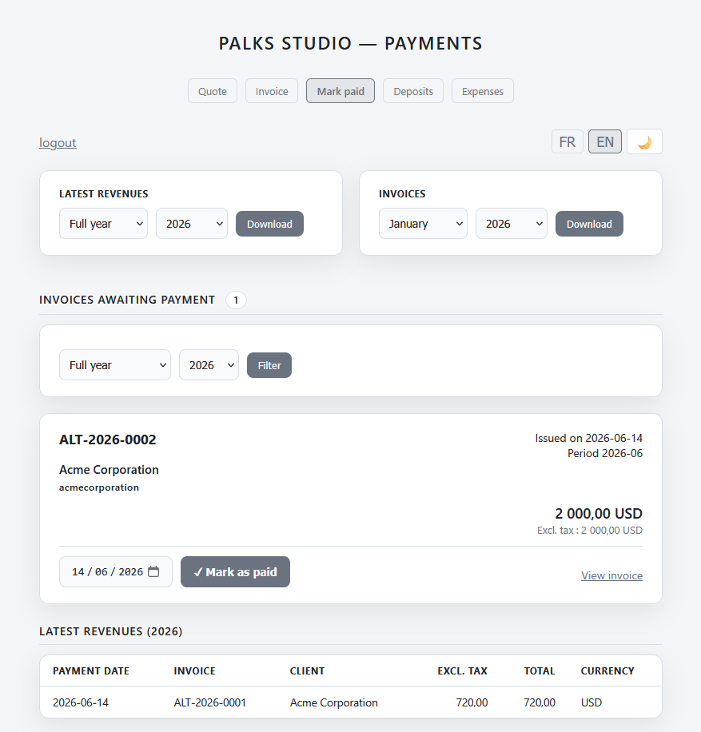

<p align="center">
  
</p>

> 🇬🇧 English | [🇫🇷 Français](./README_FR.md)


[](https://www.youtube.com/@Palks_Studio)
[](https://www.linkedin.com/in/palks-studio/)
[](https://dev.to/palks_studio/a-self-hosted-financial-system-for-freelancers-4b27)

<p align="center">
  <a href="https://palks-studio.com">
    
  </a>
</p>


# Billing System

> 🇺🇸 **For U.S. businesses**
>
> This repository presents the European version of Billing System.
>
> A dedicated **U.S. version is also available**, without Factur-X or European e-invoicing requirements. It provides the same self-hosted billing workflow, supporting both services and sales of goods.
>
> Installation and initial configuration are handled by Palks Studio directly on the client's hosting infrastructure, with no database or SaaS dependency.
>
> The U.S. version includes **manual tax management**, allowing businesses to apply the tax rates relevant to their activities and jurisdiction.
>
> **Custom tax configuration is available as an additional service.** Based on the applicable tax requirements and information provided by the client, Palks Studio can implement predefined tax rules, configure specific rates, and lock the relevant settings to automate the billing workflow according to the business's needs.
>
> 👉 [Discover the U.S. Billing System and available services](https://palks-studio.com/en/invoicing-without-saas)

> ⚠️ This repository presents the project and its technical documentation.  
> The production version is not publicly distributed.

> Installation is performed directly on the client's hosting infrastructure.  
> If you are interested in using this system, please contact **Palks Studio**.

Complete, autonomous and bilingual (FR/EN) billing system deployable on any PHP/Apache hosting. No database. No SaaS dependency. Self-hosted with full ownership of your data.

---

## Overview

Billing System is a suite of four interconnected billing tools accessible from a unified interface. It covers the full lifecycle of a service engagement: from quote generation to invoice settlement, including electronic signature and structured archiving.

The system is designed to be deployed directly on the client's server, on a standard Apache hosting environment with PHP 8.x and Composer. It requires no database, no third-party service, and no subscription.

Curious to see the full application? The complete demo playlist is available here: [Watch the Complete Demo Playlist](https://www.youtube.com/watch?v=gboIdyW5als&list=PLZEg9_eUFTGA)

The engine also includes a secure update mechanism that allows regulatory compliance to be maintained over time while preserving a fully autonomous client-hosted installation.

For a closer look at the technical architecture, this article explores the design of Billing System and the engineering choices behind a self-hosted financial system with no database or SaaS dependency.

👉 [A Self-Hosted Financial System for Freelancers](https://dev.to/palks_studio/a-self-hosted-financial-system-for-freelancers-4b27) (DEV.to)

---

## Features

- Server-side PDF quote and invoice generation (mPDF)  
- Simultaneous generation of the invoice due for payment and its paid version, stored until payment confirmation  
- Electronic quote signing by the client (touch/mouse canvas)  
- Client auto-fill from existing archives  
- Structured archiving by client and period  
- Secure sequential numbering (file locking)  
- Monthly invoice export (ZIP archive) from the interface  
- Monthly or yearly revenue export (CSV) from the interface  
- Monthly or yearly expense export (CSV) from the interface  
- Monthly or yearly deposit export (CSV) from the interface  
- Automatic document delivery by email when a client email address is provided  
- Navigation between all five modules through a shared navigation bar  
- Bilingual FR/EN interface with real-time language switching  
- Persistent dark mode / light mode  
- No database  
- No SaaS dependency  
- Secure sessions, access tokens and brute-force protection  
- 249 countries centralized in `countries.php`, with ISO codes in the backend and full country names in the interface  
- Accent-insensitive country autocomplete  
- Manual tax management based on applicable tax rates  
- Tax aggregation by rate  
- Tax column hidden in documents when no tax applies  
- Custom tax rules and locked tax settings available as an additional service, based on the client's specific tax requirements  
- Support for services, sales of goods and mixed transactions  
- Deposit recording and cumulative tracking per quote  
- Secure PDF invoice download from the payment interface  
- Deposit tracking by status (not invoiced, awaiting payment, paid), with filters and pagination  
- Monthly closing of paid deposits with CSV export and JSON archiving  
- Support for individual and business clients with automatic adaptation of business identification fields  
- Professional insurance information management (insurer, policy number and contact details)  
- Multi-user authentication with individual usernames and passwords  
- Independent user sessions with secure authentication  
- Global discount management  
- Business expense recording and tracking  
- Expense supporting documents (PDF, JPG, PNG)  
- Expense history with monthly and yearly filters  
- Standard PDF document generation without Factur-X or European e-invoicing requirements  
- Installation and initial configuration performed by Palks Studio directly on the client's hosting infrastructure

---

## Project Structure

```
private/
│
├── web/
│   │
│   ├── admin/
│   │  └── update-management.php       → Update management page
│   │
│   ├── quote-entry.php                → Quote generation entry point
│   ├── billing-entry.php              → Invoice generation entry point
│   ├── instant-bill.php               → Direct invoice generation entry point
│   ├── payment-proof.php              → Paid invoice generation entry point
│   ├── deposit-entry.php              → Entry point for deposit tracking
│   ├── expenses-entry.php             → Expense management entry point
│   │ 
│   ├── quote-space.php                → Quote generation interface
│   ├── billing-space.php              → Direct invoice generation interface
│   ├── payment-check.php              → Interface used to mark an invoice as paid
│   ├── payments.php                   → Payment and deposit tracking
│   ├── expenses-check.php             → Interface permettant de suivre les dépenses
│   ├── payments-close.php             → Monthly payment closing export
│   ├── approval.php                   → Quote review and signature interface
│   ├── archive-export.php             → ZIP export of archived invoices
│   ├── revenue-export.php             → CSV export of the revenue ledger
│   ├── expense-export.php             → CSV export of the expense journal
│   ├── deposit-export.php             → CSV export of the deposit journal
│   │
│   ├── index.php                      → PWA entry point and manifest loader
│   ├── countries.php                  → ISO-based list of 249 countries
│   ├── client-search.php              → Client lookup and autofill system
│   ├── secure-access.php              → Secure PDF access via token
│   ├── download-access.php            → Secure PDF invoice download
│   ├── deposits.php                   → Deposit payment recording
│   ├── attachment.php                 → Expense attachment viewer
│   ├── manifest.json                  → System PWA configuration
│   └── archive-save.php               → Quote saving and archival system
│
├── update-server/
│   │
│   ├── releases/                      → Published engine versions
│   │   ├── engine-release-1.0.0.zip   → Complete release archive
│   │   ├── engine-release-1.0.0.sig   → Cryptographic signature of the release
│   │   ├── engine-release-1.0.1.zip   → Complete release archive
│   │   └── engine-release-1.0.1.sig   → Cryptographic signature of the release
│   │
│   ├── api/
│   │   └── version-endpoint.php       → Client endpoint used to retrieve the latest version
│   │
│   ├── manifests/
│   │   └── release-manifest.json      → Manifest containing available version, archive and signature
│   │
│   ├── private/
│   │   ├── server-config.php          → Private release server configuration
│   │   ├── signing-private.key        → Private key used to sign releases
│   │   └── signing-public.key         → Public key used to verify release signatures
│   │
│   ├── source/
│   │   └── engine-source/             → Engine source code used to create releases
│   │       ├── xml-handler.py         → XML processing script (automatically updated)
│   │       ├── invoice.php            → Invoicing engine module (updated automatically)
│   │       ├── engine-module.py       → Engine module (automatically updated)
│   │       └── document-generator.php → Factur-X document generator (automatically updated)
│   │
│   └── tools/
│       ├── release-builder.php        → Automatic creation of release archives and manifests
│       └── release-signer.php         → Cryptographic signing of releases
│
├── assets/
│   ├── logo*                          → Company logo if provided
│   ├── signature.png                  → User signature used on quotes and invoices (PNG format)
│   └── favicon*                       → Optional favicon displayed in the browser tab
│
├── dependencies/                      → Libraries used by the document generation engine
├── templates/                         → HTML templates used for document rendering
│   └── document-layout.php            → Document rendering template (PDF or preview)
│
├── pa.php                             → PA-specific transmission connector
├── system-config.php                  → Central issuer and banking configuration
├── auth.php                           → User authentication management
├── facturx-builder.php                → Factur-X XML generation
├── facturx-injector.py                → Factur-X XML injection into the PDF
├── mail-service.php                   → Internal email delivery script with attachments
├── document-engine.php                → Main engine: generation logic, calculations and archiving
├── LICENSE.md                         → Project license
│
├── contracts/                         → Archive of signed and unsigned quotes
├── counters/                          → Document numbering counters (quotes and invoices)
├── logs/                              → System logs (optional)
├── data/
│   ├── pending-bills/                 → Archive of unpaid invoices
│   ├── staged-payments/               → Pre-generated paid invoices (awaiting payment)
│   ├── paid-bills/                    → Archived paid invoices
│   ├── temp-facturx/                  → Temporary Factur-X files
│   └── revenue-ledger/                → Revenue ledger (CSV)
│
├── updater/
│   ├── update-check-module.php        → Checks for available updates
│   ├── update-deployment-module.php   → Secure installation of updates
│   ├── update-alert-module.php        → Update notification management
│   ├── version-cache.json             → Version check cache
│   ├── verification.key               → Public key used to verify signatures
│   ├── installation-state.json        → Currently installed version
│   └── operations.log                 → Update operation log
│
├── temp/
│   └── updates/                       → Temporary directory used during installation
│
└── docs/
    ├── USER_GUIDE_FR.md               → User guide (FR)
    ├── USER_GUIDE.md                  → User guide (EN)
    ├── USER_GUIDE_FR.pdf              → User guide (FR)
    ├── USER_GUIDE.pdf                 → User guide (EN)
    ├── UPDATE_SYSTEM_FR.md            → Automatic update system documentation (FR)
    ├── UPDATE_SYSTEM.md               → Automatic update system documentation (EN)
    ├── OVERVIEW_FR.md                 → Project overview and system operation (FR)
    ├── OVERVIEW.md                    → Project overview and system operation (EN)
    ├── README_FR.md                   → Installation and usage documentation (FR)
    └── README.md                      → Installation and usage documentation (EN)
```


---

## The Five Modules

### 1. Quote generator

**How it works:**

1. The user fills in the form: business details, client details, operation type (services, sales of goods or mixed transactions), quote line items, applicable taxes, bank details, and document settings.  
2. A live preview of totals (subtotal, taxes and total) is calculated in real time.  
3. On submission, a confirmation dialog appears before generation.  
4. The PDF is generated server-side using mPDF, archived with its associated metadata, and returned to the browser for download. A secure signature token is generated with a configurable validity period (30 days by default).  
5. An email is sent to the client, when an email address is provided, with a link to review and sign the quote online.

**Technical details:**

- Automatic numbering based on the client's existing records  
- Client auto-fill from existing archives  
- Manual tax management based on the applicable tax rates  
- Custom tax rules and locked tax settings available as an additional service  
- Real-time language switch (FR/EN) without page reload  
- Currency selector: EUR, USD, GBP, CHF, CAD  
- Conditional display of banking information in the PDF  
- "Approved and agreed" section with configurable signature image  
- Support for services, sales of goods and mixed transactions  
- Automatic PDF pagination  
- Support for individual and business clients  
- Automatic adaptation of business identification fields  
- Optional professional insurance information  
- Global discount management  
- Deposit request as a percentage of the quote total  
- Optional delivery address for sales of goods  
- PDF traceability via cryptographic hash (SHA-256)

---

### 2. Direct invoicing

Server-side invoice generation interface using mPDF. For standard invoices, the system simultaneously produces two PDF documents: the invoice due for payment and its pre-generated paid version, stored until payment confirmation.

**How it works:**

1. The user fills in the form: client details, operation type, client type, professional insurance information, related quote, invoice line items, applicable taxes, service date, and any applicable deposit.  
2. A live preview of totals (subtotal, taxes and total) is calculated in real time.  
3. On submission, a confirmation dialog appears before generation.  
4. The server validates the data, generates the PDF documents, and archives the associated metadata.  
5. The invoice due for payment is downloaded and sent to the client by email when an email address is provided.  
6. The pre-generated paid version is stored in a dedicated directory until payment confirmation.

**Technical details:**

- Annual invoice numbering with collision protection  
- Protection against duplicate invoicing from the same quote reference  
- Full input validation with bilingual error handling (FR/EN)  
- Accurate financial calculations with floating-point precision handling  
- Manual tax rate selection and tax aggregation by rate  
- Custom tax rules and predefined tax settings available as an additional service  
- Automatic logo processing for PDF compatibility  
- Automatic retrieval of business information from existing metadata  
- PDF traceability via cryptographic hash (SHA-256)  
- Email delivery with PDF attachments through the internal mailer  
- Support for deposit invoices  
- Global discount management and references to deposit invoices  
- Standard PDF invoice generation without Factur-X or European e-invoicing requirements

#### Deposit tracking

The invoicing interface allows users to record deposits received against a quote.

Amounts accumulate with each entry. The total is automatically pre-filled when the form is loaded through the client lookup.

---

### 3. Payment validation and tracking

Interface for tracking outstanding invoices and confirming payments. Allows users to identify unpaid invoices, mark them as paid, and monitor revenue.

**How it works:**

1. The module automatically detects invoices awaiting payment.  
2. The user selects a payment date and clicks "Mark as paid".  
3. The system moves the pre-generated paid invoice to the paid invoice archive, updates the associated metadata, records the transaction in the revenue journal, and sends the paid invoice to the client by email when an email address is available.  
4. A table displaying the latest revenue entries of the year is shown at the bottom of the page.

**Technical details:**

- Automatic detection of invoices awaiting payment  
- Filtering of invoices already marked as paid  
- Prevention of duplicate entries in the revenue journal  
- Secure write operations with file locking  
- Protection against duplicate form submissions  
- Pending invoice counter  
- Secure PDF invoice download  
- Monthly or yearly revenue export in CSV format

---

### 4. Deposit tracking

Interface for viewing and managing deposits recorded on quotes.

**How it works:**

1. The module scans the contract archives and lists all quotes with a recorded deposit.  
2. Each entry displays a dynamically calculated status: not invoiced, awaiting payment, or paid.  
3. Entries can be filtered by status and are paginated in batches of 20.  
4. A monthly close allows users to archive deposits whose invoices have been paid.

**Monthly close:**

- Select the year and month to close  
- CSV export automatically downloaded  
- JSON archive stored in a dedicated directory  
- `archived: true` flag written to the contract metadata  
- Archived entries removed from the active view

**Technical details:**

- Read-only interface, with no changes to existing data outside the closing operation  
- Combined scan of pending and paid invoices to determine deposit status  
- Monthly archiving with structured CSV and JSON records

---

### 5. Business expense tracking

Interface for recording, tracking and archiving business expenses, including associated supporting documents.

**How it works:**

1. The user records an expense by entering the date, supplier, category, invoice number, amount and applicable taxes.  
2. A supporting document can be attached to the expense (PDF, JPG or PNG).  
3. The expense is recorded in the annual expense journal and archived with its associated document.  
4. The user can view expense history and filter records by month or year.  
5. Expense records can be exported in CSV format directly from the interface.

**Technical details:**

- Structured annual expense journal  
- Monthly and yearly filters  
- Expense categorization  
- Manual recording of applicable taxes  
- Supporting document storage (PDF, JPG, PNG)  
- Secure access to expense attachments  
- Automatic archiving by year  
- Monthly or yearly CSV export  
- Multi-user support

---

### Shared modules

#### Electronic signature

Public page accessible via a secure tokenized link. Allows the client to view the quote and provide an electronic signature.

- Multi-page PDF preview in the browser  
- Signature capture (touch and mouse compatible)  
- Input validation (format and minimum size)  
- Signature image storage  
- Metadata update with signature timestamp and traceability  
- Confirmation emails sent to both client and issuer (FR/EN)  
- Protection against duplicate signing  
- Configurable link expiration (30 days by default)

#### Client auto-fill

JSON endpoint used during form input. Searches existing records based on client identification details, email, name or quote number.

- Returns complete client details, client type, language, currency and associated data  
- Allows automatic pre-fill of invoice data from previous quotes  
- Input normalization for consistent matching

#### Secure PDF access

Token-based access layer for serving PDF files without exposing their physical location on the server.

#### Internal mailer

Internal email delivery module with attachment support, used across all features. No external SMTP service is required.

- Automatic delivery of quotes, invoices and paid invoices  
- Electronic signature links and confirmation emails  
- Email content adapted to the document language (FR/EN)  
- Document delivery when a valid client email address is provided

#### Installation and tax configuration

Each installation is configured by Palks Studio directly on the client's hosting infrastructure through a dedicated configuration interface.

The initial configuration includes business identification details, banking information, document numbering, branding and billing preferences.

The U.S. version provides manual tax management, allowing businesses to select the applicable tax rates according to their activities and jurisdiction.

Custom tax rules, predefined rates and locked tax settings can be implemented as an additional service, based on the applicable tax requirements and information provided by the client.

The system remains fully self-hosted, with no database or SaaS dependency.

---

## Engine Update System

The system includes a secure update mechanism designed to maintain and improve the billing engine over time.

Each client installation periodically checks the Palks Studio update server for the availability of a new version.

When a new version is available:

- A notification appears across all system interfaces  
- The user can view the update information  
- The user can start the installation directly from the notification

The update process:

- Downloads only the required engine components  
- Verifies the cryptographic signature of the release  
- Creates a backup before modification  
- Replaces only the necessary files  
- Keeps client data and local configurations unchanged  
- Updates the installed version

This mechanism allows the billing engine to receive technical improvements and maintenance updates while preserving the autonomy of each client-hosted installation.

---

## Security

- Secure session management (protected cookies, access isolation)  
- Protection against brute-force attempts  
- Session identifier regeneration after authentication  
- Secure tokens for accessing sensitive resources  
- Strict validation of inputs and identifiers  
- Action traceability via cryptographic hashing  
- Endpoint protection through access control mechanisms  
- HTTP response security policies (content type, caching, indexing)  
- Internal interfaces protected by authentication and excluded from search engine indexing  
- No SaaS dependency, with client data remaining under full control  
- Multi-user authentication via dedicated user accounts  
- Double validation of sensitive data on both the interface and the server  
- Installation-specific configuration managed by Palks Studio

---

## Automatic Emails

| Event                | Recipient(s)    | Content                            |
|----------------------|-----------------|------------------------------------|
| Quote generation     | Client          | Signature link + PDF download link |
| Quote signed         | Client + Issuer | Signature confirmation + PDF link  |
| Invoice generation   | Client          | Invoice as PDF attachment          |
| Payment confirmation | Client          | Paid invoice as PDF attachment     |

All emails are bilingual FR/EN based on the document language.

Automatic email delivery requires a valid recipient email address and an enabled email configuration.

---

## Technical Requirements

- PHP 8.1 or higher  
- Compatible web server (Apache recommended)  
- URL rewriting support  
- Composer for PHP dependencies  
- GD extension (image processing)  
- Email sending capability enabled on the server  
- Write permissions on storage and archive directories  
- Internet access for checking and downloading engine updates

Installation and initial configuration are performed by Palks Studio directly on the client's hosting infrastructure.

No database, SaaS subscription or external invoicing platform is required.

---

## Data Storage

All data is stored using flat files. No database is required.

| Type                    | Description                                                | Format           |
|-------------------------|------------------------------------------------------------|------------------|
| Quotes                  | Archived with associated metadata                          | PDF + JSON       |
| Signatures              | Stored as image files                                      | PNG              |
| Invoices                | Archived invoices due for payment with associated metadata | PDF + JSON       |
| Pending paid invoices   | Pre-generated paid versions awaiting payment confirmation  | PDF              |
| Validated paid invoices | Archived after payment confirmation                        | PDF              |
| Revenue records         | Structured transaction journal                             | CSV              |
| Expense records         | Structured business expense journal                        | CSV              |
| Expense attachments     | Supporting documents associated with expenses              | PDF, JPG, PNG    |
| Counters                | Sequential document numbering                              | Integer          |
| Logs                    | System activity tracking                                   | Timestamped text |
| Deposit archives        | Monthly archive of closed deposits                         | JSON + CSV       |

All business data, documents and archives remain stored on the client's own hosting infrastructure.

---

© Palks Studio — see LICENSE.md  
- https://palks-studio.com
